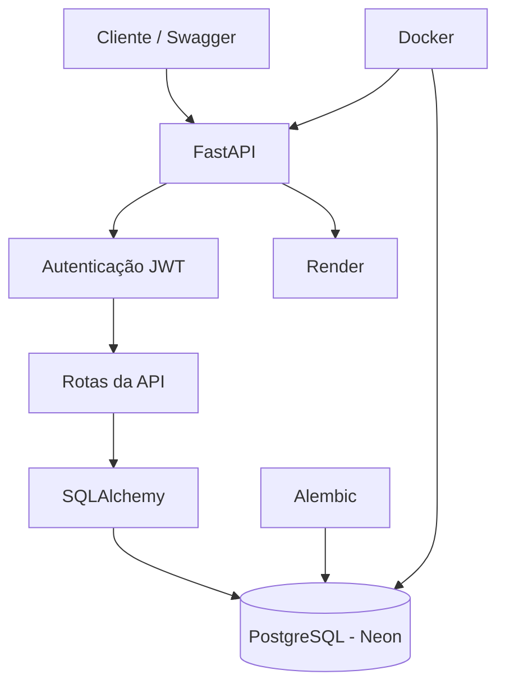

# OrderFlow API

API REST para gerenciamento de clientes, produtos e pedidos, desenvolvida com Python e FastAPI.

O **OrderFlow API** simula o backend de um sistema de vendas, oferecendo autenticação de usuários, controle de permissões, gerenciamento de estoque e processamento de pedidos.

**Acesse o projeto:**
- 🌐 API em produção: https://orderflow-api-3idx.onrender.com
- 📚 Documentação Swagger: https://orderflow-api-3idx.onrender.com/docs

## Tecnologias utilizadas

- **Python** — linguagem principal.
- **FastAPI** — construção da API REST.
- **PostgreSQL** — banco de dados relacional.
- **SQLAlchemy** — ORM para comunicação com o banco.
- **Alembic** — gerenciamento de migrações.
- **JWT** — autenticação e autorização.
- **Passlib / Bcrypt** — criptografia de senhas.
- **Docker e Docker Compose** — containerização e ambiente de execução.
- **Neon** — hospedagem do banco de dados.
- **Render** — hospedagem da API.

## Funcionalidades

### Clientes e autenticação
- Cadastro de clientes.
- Criptografia de senhas.
- Login com autenticação JWT.
- Geração de Access Token e Refresh Token.
- Diferenciação entre clientes e administradores.
- Controle de acesso às rotas protegidas.

### Produtos
- Cadastro de produtos.
- Listagem e consulta de produtos.
- Atualização de produtos.
- Exclusão de produtos.
- Controle de permissões para administradores.

### Pedidos
- Criação de pedidos com múltiplos itens.
- Cálculo automático do valor total.
- Verificação de disponibilidade em estoque.
- Atualização automática do estoque.
- Consulta de pedidos.
- Cancelamento de pedidos com restauração do estoque.
- Atualização do status dos pedidos por administradores.
- Controle de acesso aos pedidos por proprietário.

## Arquitetura do projeto



## Estrutura de pastas

```text
orderflow-api/
│
├── app/
│   ├── main.py
│   ├── models.py
│   ├── schemas.py
│   ├── dependencies.py
│   ├── security.py
│   │
│   └── routes/
│       ├── clientes_routes.py
│       ├── produtos_routes.py
│       └── pedidos_routes.py
│
├── alembic/
│   └── versions/
│
├── Dockerfile
├── docker-compose.yml
├── .dockerignore
├── .gitignore
├── alembic.ini
└── requirements.txt
```

## Executando localmente

### Pré-requisitos

- Python 3.13+
- Docker Desktop
- Git

### 1. Clone o repositório

```bash
git clone https://github.com/Luizzhcs/orderflow-api.git
cd orderflow-api
```

### 2. Configure as variáveis de ambiente

Crie um arquivo `.env` na raiz do projeto com as seguintes variáveis:

```env
POSTGRES_USER=postgres
POSTGRES_PASSWORD=sua_senha
POSTGRES_DB=orderflow

SECRET_KEY=sua_chave_secreta
ALGORITHM=HS256
ACCESS_TOKEN_EXPIRE_MINUTES=30
```

Não compartilhe seu arquivo `.env` ou envie credenciais para o GitHub.

### 3. Inicie os containers

```bash
docker compose up -d --build
```

### 4. Execute as migrações

```bash
docker compose exec api alembic upgrade head
```

### 5. Acesse a documentação

http://localhost:8000/docs

## Deploy

O projeto está publicado utilizando:

- **Render:** hospedagem da API.
- **Neon:** banco de dados PostgreSQL.

A documentação interativa pode ser acessada publicamente pelo Swagger.

## Autor

Desenvolvido por **Luiz Henrique**.

- GitHub: https://github.com/Luizzhcs
- LinkedIn: https://www.linkedin.com/in/luiz-henrique-2763aa30b/

---

Projeto desenvolvido para praticar e demonstrar conhecimentos em desenvolvimento Backend com Python e FastAPI.